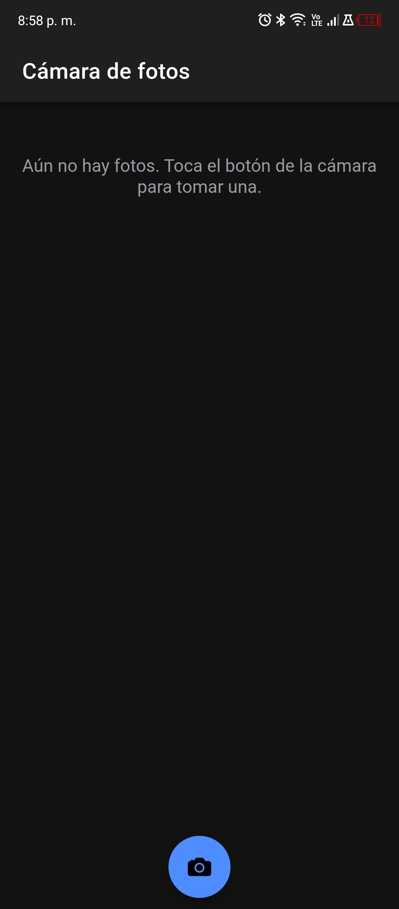
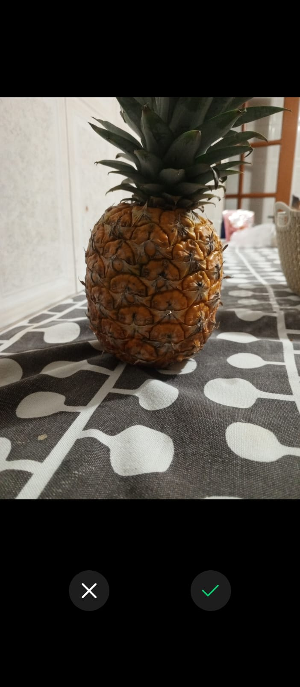
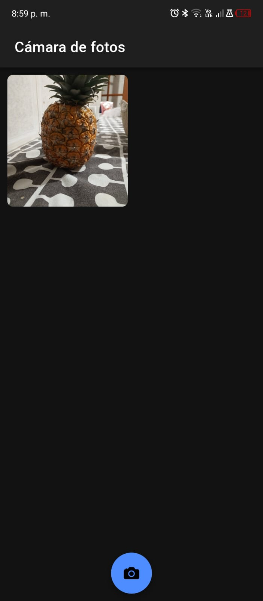
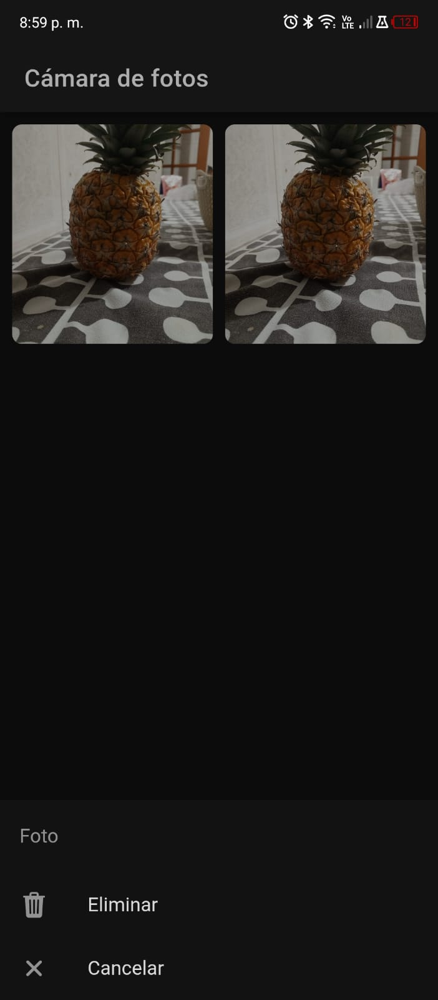
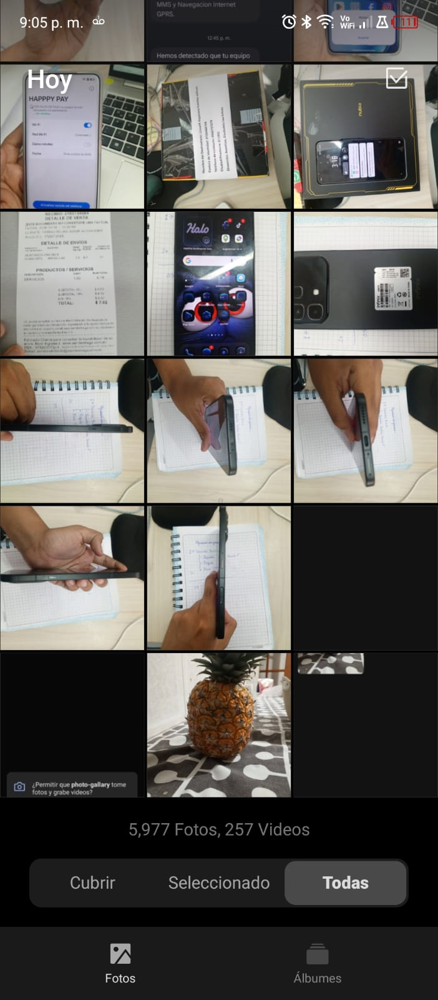

# 📷 Foto Android — Cámara de fotos con Ionic

Aplicación móvil hecha con **Ionic + Angular + Capacitor** que permite **tomar fotos, guardarlas y eliminarlas**. Cada foto se guarda en el almacenamiento de la app (para administrarla dentro de la galería de la aplicación) y además se copia en la **galería del teléfono**.

## Funcionalidades

- Tomar fotos con la cámara del dispositivo.
- Guardar cada foto en la galería del teléfono y en el almacenamiento de la app.
- Ver las fotos en una cuadrícula; se conservan al cerrar y volver a abrir la app.
- Eliminar una foto tocándola y eligiendo **Eliminar** en el menú de acciones.

## Capturas de pantalla

> Reemplaza estas imágenes por tus capturas reales (carpeta `docs/screenshots/`).

| Galería vacía | Tomando la foto | Galería con fotos |
|:---:|:---:|:---:|
|  |  |  |

| Menú para eliminar | Foto eliminada | Foto en la galería del teléfono |
|:---:|:---:|:---:|
|  |  |  |

## Tecnologías

| Tecnología | Uso |
|---|---|
| Ionic + Angular (standalone) | Interfaz y componentes |
| `@capacitor/camera` | Tomar la foto y copiarla a la galería del teléfono |
| `@capacitor/filesystem` | Guardar y borrar los archivos de imagen |
| `@capacitor/preferences` | Recordar la lista de fotos entre sesiones |
| `@ionic/pwa-elements` | Cámara cuando se prueba en el navegador |

## Estructura del proyecto

```
src/app/
├── gallery/gallery.page.*     # Pantalla principal: cuadrícula, botón de cámara, menú de eliminar
├── services/photo.service.ts  # Lógica: tomar, guardar, cargar y eliminar fotos
├── app.routes.ts              # Ruta a la galería
android/                       # Proyecto Android generado por Capacitor
```

## Cómo funciona

1. **Tomar y guardar** — `PhotoService.addNewToGallery()` abre la cámara con `Camera.getPhoto({ saveToGallery: true })`. La foto se copia en la galería del teléfono, se escribe en `Directory.Data` con `Filesystem.writeFile` y se agrega a la lista.
2. **Persistencia** — los nombres de archivo se guardan con `Preferences`; al abrir la app, `loadSaved()` lee cada archivo y reconstruye la galería.
3. **Eliminar** — al tocar una foto se muestra un `ActionSheet`. Al confirmar, `deletePicture()` la quita de la lista, actualiza `Preferences` y borra el archivo con `Filesystem.deleteFile`.

> **Nota:** la eliminación borra la foto de la galería de la aplicación. La copia que `saveToGallery` dejó en la galería del teléfono no se borra desde la app, porque Android (almacenamiento con alcance, Android 10+) exige confirmación del sistema para borrar medios y los plugins oficiales de Capacitor no lo ofrecen. Esa copia se elimina desde la app Galería del teléfono.

## Permisos de Android

En `android/app/src/main/AndroidManifest.xml`:

```xml
<uses-permission android:name="android.permission.CAMERA" />
<uses-permission android:name="android.permission.WRITE_EXTERNAL_STORAGE" android:maxSdkVersion="28" />
<uses-feature android:name="android.hardware.camera" android:required="false" />
```

## Requisitos previos

- Node.js (versión compatible con Angular CLI; ver `package.json`) y npm
- Ionic CLI: `npm install -g @ionic/cli`
- Android Studio con un SDK instalado, y un teléfono Android con depuración USB o un emulador

## Instalación y ejecución

```bash
# 1. Clonar el repositorio
git clone <URL-DE-TU-REPOSITORIO>
cd foto-android

# 2. Instalar dependencias
npm install

# 3. Probar en el navegador (usa pwa-elements para la cámara)
ionic serve

# 4. Compilar y sincronizar con Android
ionic build
npx cap sync android

# 5. Abrir en Android Studio y ejecutar en el teléfono
npx cap open android
```

Para ejecutar directo en un dispositivo conectado: `ionic cap run android -l --external`.

## Cómo probar la app

1. Abre la app y toca el botón circular de la cámara; acepta el permiso.
2. Toma una foto: aparece en la cuadrícula.
3. Revisa la app Galería del teléfono: la foto también está ahí.
4. Cierra y vuelve a abrir la app: las fotos siguen en la cuadrícula.
5. Toca una foto → **Eliminar**: desaparece de la cuadrícula.

## Autor

Josue Alexander Patiño Rojas — ESFOT, Escuela Politécnica Nacional.
